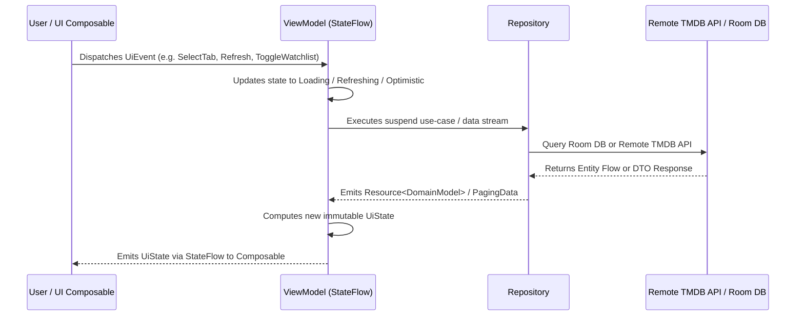

<p align="center">
  
</p>

<h1 align="center">Golek Pilem</h1>

<p align="center">
  <a href="https://github.com/prayogizan/Golek-Pilem/releases/tag/v1.0.0"></a>
  <a href="https://kotlinlang.org"></a>
  <a href="https://developer.android.com/studio/releases/gradle-plugin"></a>
  <a href="https://developer.android.com/jetpack/compose"></a>
  <a href="https://m3.material.io"></a>
  <a href="https://insert-koin.io/"></a>
  <a href="https://developer.android.com/training/data-storage/room"></a>
  <a href="https://developer.android.com/topic/libraries/architecture/paging/v3-overview"></a>
  <a href="https://coil-kt.github.io/coil/"></a>
  <a href="https://developer.android.com/training/testing"></a>
  <a href="https://developer.android.com"></a>
  <a href="https://developer.android.com"></a>
  <a href="https://developer.android.com/topic/architecture"></a>
  <a href="LICENSE"></a>
</p>

<p align="center">
  <strong>Golek Pilem</strong> (<em>Javanese for "Search Movies" / "Find Movies"</em>) is an enterprise-grade Android reference application designed to discover, track, and inspect popular movies and television series. Built natively with <strong>Jetpack Compose</strong>, <strong>Material 3</strong>, and <strong>Clean Architecture</strong>, it showcases cutting-edge Android engineering practices: offline-first Room persistence, Paging 3 RemoteMediator pagination, Coil 3 persistent disk caching, granular storage governance, non-destructive swipe-to-refresh revalidation, in-app YouTube video streaming, and an automated test suite of <strong>185 unit tests</strong>.
</p>

<p align="center">
  Powered by <a href="https://www.themoviedb.org/">The Movie Database (TMDB) API</a>.
</p>

---

## 📑 Table of Contents

- [📸 Screenshots & Demo](#-screenshots--screen-recording)
- [✨ Features](#-features)
- [🏛 Architecture & Design Principles](#-architecture--design-principles)
- [🛠 Tech Stack & Libraries](#-tech-stack--libraries)
- [📁 Project Directory Structure](#-project-directory-structure)
- [🚀 Getting Started & Setup](#-getting-started--setup)
- [🧪 Testing & Quality Assurance](#-testing--quality-assurance)
- [📜 TMDB Attribution & License](#-tmdb-attribution--license)

---

## 📸 Screenshots & Screen Recording

### 📱 Screenshots

### Darkmode

   <br>   


<br><br>

### Lightmode

   <br>   


---

### 🎥 Screen Recording & Demo

[click to see the video](https://drive.google.com/file/d/1XlL25yTHK2_Ahvj28wQw_CCyR2S4ofD2/view?usp=sharing)


---

## ✨ Features

### 🎞️ Triple-Tab Discovery Feed & Watchlist
- **Movies, TV Series & Watchlist Tabs**: Rapid switching across popular movies, trending television series, and personal offline bookmarks.
- **Reactive Tab Badges**: Real-time counter badge on the Watchlist tab (`BadgedBox`) reflecting saved bookmark counts reactively without manual screen refreshes.
- **Collapsible Top App Bar**: Uses `enterAlwaysScrollBehavior` to collapse both the top header and tab bar on downward scroll and immediately reveal them on upward scroll.
- **Scroll State Preservation**: Preserves independent scroll positions (`LazyStaggeredGridState`) across tab switches.
- **Adaptive Staggered Grid**: Responsive multi-column layout for rich poster cards with staggered aspect ratios.
- **Storage Diagnostics Action**: Dedicated top app bar icon opening the storage and cache management console.

### 🔄 Material 3 Swipe-to-Refresh (`PullToRefreshBox`)
- **Discovery Feeds**: Integrated `@OptIn(ExperimentalMaterial3Api::class) PullToRefreshBox` across Movies, TV Series, and Watchlist tabs.
- **Non-Destructive Detail Revalidation**: Swiping down on the media detail screen revalidates metadata against remote TMDB endpoints while retaining existing screen content—eliminating disruptive skeleton shimmer flashes.
- **System Inset Awareness**: Refresh indicators employ `.statusBarsPadding()` to float cleanly below camera notches and prevent colliding with navigation controls.
- **Graceful Error Recovery**: If an on-demand refresh fails due to network outage, cached metadata remains displayed on screen and a transient error `Snackbar` is dispatched.
- **Scrollable Empty & Error States**: Attached `.verticalScroll(rememberScrollState())` to empty and error containers, ensuring swipe gestures reach the nested scroll connection even when content does not fill the viewport.

### 💾 Offline-First Architecture (Room Database & RemoteMediator)
- **Single Source of Truth (SSOT)**: Implements AndroidX Paging 3 `RemoteMediator` with Room database (`GolekPilemDatabase`). Discovery feeds load instantly from disk and stream updates seamlessly as new pages arrive from TMDB.
- **Stale-While-Revalidate (SWR) Detail Caching**: Movie and TV series details are cached in Room with a 24-hour validity window. Cached records render instantaneously on screen while background network calls quietly revalidate metadata.
- **Visual Offline Cached Badge**: Subtle animated indicator (`DetailScreen`) informing the user when media metadata is being served from local offline storage.

### 🔖 Watchlist & Bookmarking
- **One-Tap Bookmark Toggle**: Floating action in the detail screen top bar allowing users to save or remove titles from their personal watchlist.
- **Smooth Morphing Animation**: State toggles animate smoothly using a 200ms `Crossfade` between Cinema Crimson `Icons.Filled.Bookmark` and muted `Icons.Outlined.BookmarkBorder`.
- **Feedback & Undo**: Transient notifications with string resources (`R.string.msg_added_to_watchlist`, `R.string.msg_removed_from_watchlist`) via Compose `SnackbarHost`.

### 🧹 Storage Diagnostics & Disk Cache Governance
- **Persistent Coil 3 Disk Cache**: Dedicated 250MB LRU disk cache located in the app cache directory (`image_cache`), managed with Okio and bound globally through `SingletonImageLoader.Factory`.
- **Storage Maintenance Modal (`StorageSettingsDialog`)**: Diagnostic dialog presenting granular device space metrics:
  - **Total App Storage**: Combined footprint of application cache and internal databases.
  - **Coil Image Cache**: Space occupied by cached movie posters and backdrops.
  - **Room Database Storage**: Physical SQLite database, WAL files, and schema storage.
  - **System & General Cache**: Temporary cache footprint.
- **One-Tap "Clear Cache"**: Flushes Coil disk cache and temporary files safely without touching bookmarked watchlist records.
- **Watchlist-Exempt Catalog Pruning**: Routine maintenance routine (`purgeExpiredCatalog`) safely purges unbookmarked catalog media and pagination remote keys older than 7 days, strictly exempting records present in the user's watchlist via SQL `NOT EXISTS`.

### 🍿 In-App Trailer Player & YouTube Integration
- Real-time video resolution via TMDB Videos API (`/movie/{id}/videos` & `/tv/{id}/videos`) with priority sorting for official trailers.
- **Embedded Player**: In-app WebView trailer playback with landscape orientation support.
- **External Intent Fallback**: Direct launch to the native YouTube Android application or web browser with one tap.

### 💬 Community Reviews & Comprehensive Metadata
- Paginated user reviews from TMDB API with author avatars, ratings, and submission dates.
- Expandable review body cards with "Read more" / "Show less" toggling for lengthy reviews.
- Formatted runtimes (`Xh Ym`), season/episode counts, release status, total vote counts, and horizontal scrolling genre chips.

### 🎨 Dark Mode, Error Recovery & Accessibility
- **Material 3 High-Contrast Dark Theme**: Custom dark color palette (`#121212` background, `#1E1E1E` surface, `#282828` surfaceVariant, `#EEEEEE` onSurface) engineered for cinematic immersion and conforming to **WCAG AA** standards.
- **Robust Error Recovery**: Full-screen recovery view (`ErrorScreen`) handling offline connection drops, HTTP 401 configuration errors, and HTTP 500+ server outages with 1000ms debounced retry actions.
- **HTTP 429 Rate Limiting**: Transport-layer rate limit interceptor (`RateLimitRetryInterceptor`) with exponential backoff and `Retry-After` header parsing.
- **Accessibility (a11y)**: Strict $\ge 48\text{dp} \times 48\text{dp}$ touch target compliance across all interactive elements with complete content descriptions.

---

## 🏛 Architecture & Design Principles

Golek Pilem strictly enforces **Clean Architecture** and **Unidirectional Data Flow (UDF)**, ensuring complete separation of concerns, testability, and scalability.

```
┌────────────────────────────────────────────────────────┐
│               Presentation Layer (UI)                  │
│    Jetpack Compose UI, ViewModels, UiState, UiEvent    │
└───────────────────────────┬────────────────────────────┘
                            │ (depends on)
                            ▼
┌────────────────────────────────────────────────────────┐
│                Domain Layer (Core)                     │
│    Domain Models, Repository Interfaces, Use Cases     │
│    (Pure Kotlin — ZERO Android / Network / DB imports) │
└───────────────────────────▲────────────────────────────┘
                            │ (implements)
┌───────────────────────────┴────────────────────────────┐
│                 Data Layer (Infra)                     │
│    Retrofit ApiService, Room DB, DTOs, Mappers,        │
│    RemoteMediator, StorageManager, Repositories        │
└────────────────────────────────────────────────────────┘
```

### 1. Architectural Layers

- **Presentation Layer (`com.prayogizan.golekpilem.ui`)**:
  - Implements the **Route vs Screen Separation Pattern**:
    - `*Route.kt`: Stateful composable responsible for dependency injection (`koinViewModel()`), lifecycle-aware state collection (`collectAsStateWithLifecycle()`), and navigation event dispatching.
    - `*Screen.kt`: Pure, stateless composable driven solely by immutable `UiState` and event lambdas `(UiEvent) -> Unit`, with full `@Preview` support for both Light and Dark themes.
  - Type-safe Compose navigation using Kotlinx Serialization (`Screen.Main`, `Screen.Detail(id, mediaType)`).

- **Domain Layer (`com.prayogizan.golekpilem.domain`)**:
  - **Pure Kotlin**: Free of any Android framework, network, or third-party database imports.
  - **Use Cases / Interactors**: Single-responsibility interactors exposing an `operator fun invoke(...)` (e.g., `GetMoviesUseCase`, `GetMovieDetailUseCase`, `GetWatchlistUseCase`, `GetStorageStatsUseCase`).
  - **Contracts**: Abstract repository interfaces (`MovieRepository`, `TvRepository`, `WatchlistRepository`, `StorageRepository`).

- **Data Layer (`com.prayogizan.golekpilem.data`)**:
  - **Remote (`data/remote`)**: Retrofit API interfaces and pure `@Serializable` DTOs.
  - **Local (`data/local`)**: Room database (`GolekPilemDatabase`), entities (`MediaEntity`, `RemoteKeyEntity`, `WatchlistEntity`, `MediaDetailEntity`), DAOs, type converters, and `StorageManager`.
  - **Mediators (`data/local/mediator`)**: Paging 3 `RemoteMediator` coordinating network updates into Room.
  - **Mappers (`data/mapper`)**: Defensive transformation functions mapping DTOs and Room entities to Domain models.
  - **Repositories (`data/repository`)**: Concrete implementations coordinating remote APIs, Room caches, and reactive Flow streams.

- **Core Layer (`com.prayogizan.golekpilem.core`)**:
  - Cross-cutting network configurations, HTTP Bearer authentication interceptor (`AuthInterceptor`), constants, and resource wrappers (`Resource`).

### 2. SOLID Principles in Practice

- **S — Single Responsibility**: DTOs parse JSON; Room entities represent SQLite tables; Mappers transform data defensively; Domain models hold business entities; ViewModels manage UI state; Composables render UI.
- **O — Open/Closed**: Repositories and data sources are abstracted behind interfaces. Offline caching and cache pruning were added seamlessly without altering domain use case signatures.
- **L — Liskov Substitution**: Repository implementations are completely swappable with test doubles (`FakeMovieRepository`, `FakeTvRepository`) in unit tests.
- **I — Interface Segregation**: Distinct, focused repository interfaces (`MovieRepository`, `TvRepository`, `WatchlistRepository`, `StorageRepository`) prevent bloated monolithic contracts.
- **D — Dependency Inversion**: Presentation and Domain layers depend on abstractions; Koin wires implementations into consumers.

### 3. State Management & Unidirectional Data Flow (UDF)

Each feature screen strictly implements the **Unidirectional Data Flow (UDF)** pattern:



#### UDF Architecture Mapping in Golek Pilem

| UDF Architectural Component | Golek Pilem Component | Implementation Details |
|---|---|---|
| **UI Composable** | `MainScreen`, `DetailScreen`, `StorageSettingsDialog` | Stateless composables driven purely by `UiState` and event callback `(UiEvent) -> Unit`. |
| **Stateful Route Wrapper** | `MainRoute`, `DetailRoute` | Injects ViewModel via Koin (`koinViewModel()`), collects state lifecycle-safely (`collectAsStateWithLifecycle()`), and binds navigation. |
| **UiAction / UiEvent** | `MainUiEvent`, `DetailUiEvent`, `StorageUiEvent` | Sealed interfaces capturing all user intents (`SelectTab`, `Refresh`, `RefreshWatchlist`, `ToggleWatchlist`). |
| **ViewModel (StateFlow)** | `MainViewModel`, `DetailViewModel`, `StorageViewModel` | Owns private `MutableStateFlow`, exposes public read-only `StateFlow<UiState>`, and processes events in `onEvent()`. |
| **UiState** | `MainUiState`, `DetailUiState`, `StorageUiState` | Strongly-typed immutable state models: tab index and watchlist count in `MainUiState`, LCE and refresh states in `DetailUiState`. |
| **Domain Interactor** | `GetMoviesUseCase`, `GetMovieDetailUseCase`, `GetWatchlistUseCase`, etc. | Pure Kotlin use cases orchestrating business logic and repository execution. |
| **Repository & Data Source** | `MovieRepositoryImpl`, `TvRepositoryImpl`, `WatchlistRepositoryImpl`, `StorageRepositoryImpl` | Coordinates TMDB remote API calls via Retrofit, manages Room persistence, applies defensive mappers, and emits `Resource<T>` or `PagingData<T>`. |
| **Local / Remote Storage** | `GolekPilemDatabase`, `TmdbApiService`, OkHttp Client | Room SQLite database with 4 DAOs; Coil 3 Okio disk cache; Remote TMDB REST endpoints. |

---

## 🛠 Tech Stack & Libraries

| Category | Technology / Library | Version | Description |
| :--- | :--- | :--- | :--- |
| **Language** | Kotlin | `2.2.10` | First-class language features, Coroutines & Flow |
| **Build Tool** | Android Gradle Plugin | `9.4.1` | Gradle build automation with version catalogs |
| **UI Framework** | Jetpack Compose | `BOM 2026.02.01` | Modern declarative UI toolkit |
| **Design System** | Material Design 3 | Latest | Modern Material components, PullToRefreshBox, theming |
| **Dependency Injection** | Koin | `4.0.2` | Pragmatic DI for Kotlin, Android & Compose |
| **Local Database** | AndroidX Room | `2.7.0` | SQLite abstraction with Kotlin Coroutines Flow support |
| **Pagination** | AndroidX Paging 3 | `3.3.6` | RemoteMediator infinite scrolling & reactive load states |
| **Image Loading** | Coil 3 | `3.1.0` | Kotlin-first image loader with 250MB persistent disk cache |
| **Networking** | Retrofit & OkHttp | `2.11.0` / `4.12.0` | Type-safe HTTP client with logging, rate limit & auth interceptors |
| **Serialization** | Kotlinx Serialization | `1.7.3` | High-performance JSON parser & route serializer |
| **Navigation** | Navigation Compose | `2.8.9` | Type-safe declarative destination navigation |
| **Testing** | JUnit4, MockK, Turbine | `4.13.2` / `1.13.13` / `1.2.0` | Unit testing, mocking, and coroutine flow testing |
| **Mock Web Server** | OkHttp MockWebServer | `4.12.0` | Testing HTTP serialization and network responses |

---

## 📁 Project Directory Structure

```
com.prayogizan.golekpilem
├── GolekPilemApp.kt                  # Application class, Koin bootstrap & Coil SingletonImageLoader.Factory
├── MainActivity.kt                   # Single Activity host with Edge-to-Edge support
│
├── core/                             # Cross-cutting concerns
│   ├── connectivity/                 # Reactive network connectivity observers (ConnectivityObserver)
│   ├── constants/                    # Global constants (ApiConstants)
│   ├── di/                           # Core DI modules (NetworkModule, CoreModule, AppModule)
│   └── util/                         # Resource wrappers, ErrorMessageResolver & extensions
│
├── domain/                           # Pure Kotlin Domain Layer (Zero Android dependencies)
│   ├── model/                        # Business models (Movie, TvSeries, Details, MediaItem, StorageStats)
│   ├── repository/                   # Abstract repository contracts (MovieRepository, TvRepository, WatchlistRepository, StorageRepository)
│   ├── usecase/                      # Single-purpose interactors (GetMoviesUseCase, ToggleWatchlistUseCase, GetStorageStatsUseCase)
│   └── di/                           # Domain Koin module (DomainModule)
│
├── data/                             # Data & Infrastructure Layer
│   ├── local/                        # Local Room database & caching infrastructure
│   │   ├── converter/                # Room TypeConverters (Converters)
│   │   ├── dao/                      # Data Access Objects (MediaDao, RemoteKeyDao, MediaDetailDao, WatchlistDao)
│   │   ├── db/                       # RoomDatabase definition (GolekPilemDatabase)
│   │   ├── entity/                   # Database Entities (MediaEntity, RemoteKeyEntity, MediaDetailEntity, WatchlistEntity)
│   │   ├── mediator/                 # Paging 3 RemoteMediator (MediaRemoteMediator)
│   │   └── storage/                  # Storage diagnostics & cache maintenance (StorageManager)
│   ├── remote/
│   │   ├── api/                      # Retrofit interfaces (TmdbApiService)
│   │   └── dto/                      # Serializable network DTOs (*Dto)
│   ├── mapper/                       # Defensive DTO & Entity to Domain mappers (*Mapper)
│   ├── repository/                   # Repository implementations (*RepositoryImpl)
│   └── di/                           # Data Koin modules (DataModule, DatabaseModule)
│
└── ui/                               # Presentation Layer
    ├── common/                       # Reusable UI components (Shimmer, ErrorScreen, StorageSettingsDialog, GenreChips)
    ├── navigation/                   # Type-safe Screen routes & GolekPilemNavGraph
    ├── main/                         # Discovery catalog feed (MainRoute, MainScreen, MainViewModel)
    │   └── components/               # MediaGridCard, EmptyFeedView, EmptyWatchlistView, PaginationStatusItems
    ├── detail/                       # Media detail screen (DetailRoute, DetailScreen, DetailViewModel)
    │   └── components/               # DetailHeader, DetailMetadata, TrailersSection, ReviewsSection, FullScreenTrailerPlayer
    ├── theme/                        # Color, Typography, Shapes, Spacing, GolekPilemTheme
    └── di/                           # Presentation Koin module (PresentationModule)
```

---

## 🚀 Getting Started & Setup

### Prerequisites

- **Android Studio**: Ladybug (2024.2.1) or newer
- **JDK**: Java 11 or higher (JVM 25 compatible Gradle daemon)
- **Android SDK**: `compileSdk 37`, `minSdk 24`, `targetSdk 37`
- **TMDB API Read Access Token (v4)**: Create a free account on [The Movie Database (TMDB)](https://www.themoviedb.org/) and generate an API Read Access Token under your account settings.

### 1. Clone Repository

```bash
git clone https://github.com/prayogizan/Golek-Pilem.git
cd Golek-Pilem
```

### 2. Configure TMDB API Token

Provide your TMDB Access Token using either of the following methods:

#### Option A: `local.properties` (Recommended for local development)
Add the following line to `local.properties` in the project root:

```properties
TMDB_ACCESS_TOKEN=your_tmdb_v4_read_access_token_here
```

#### Option B: Environment Variable (Recommended for CI/CD)
Set the environment variable:

```bash
export TMDB_ACCESS_TOKEN="your_tmdb_v4_read_access_token_here"
```

### 3. Build & Run

- Open the project in Android Studio.
- Sync Gradle projects with build files.
- Select your target emulator or physical device (Android 7.0 / API 24+).
- Press **Run 'app'** (`Shift + F10`) or execute via terminal:

```bash
# Assemble Debug APK
./gradlew assembleDebug

# Install on connected device
./gradlew installDebug
```

---

## 🧪 Testing & Quality Assurance

The project enforces strict automated testing across all architectural layers, with a total of **185 automated unit tests** executing in under 10 seconds.

### Test Coverage Highlights

- **Domain Layer**:
  - Unit tests validating business rules and use cases with `MockK` (`GetMoviesUseCaseTest`, `GetMovieDetailUseCaseTest`, `GetTvSeriesUseCaseTest`, `GetTvSeriesDetailUseCaseTest`, `GetWatchlistUseCaseTest`, `ToggleWatchlistUseCaseTest`, `GetStorageStatsUseCaseTest`, `ClearAppCacheUseCaseTest`, `PruneStorageUseCaseTest`).
- **Data Layer**:
  - **DTO Serialization**: Verifies JSON parsing resilience and unknown key resistance (`TmdbDtoSerializationTest`).
  - **Defensive Mappers**: Boundary condition tests for null URLs, unreleased dates, and score rounding (`MovieMapperTest`, `TvMapperTest`, `MediaDetailEntityMapperTest`).
  - **Network Contracts**: Mocked HTTP interaction tests using OkHttp `MockWebServer` (`TmdbApiServiceTest`).
  - **Local Room Database**: DAOs tested with in-memory SQLite instances verifying pagination, conflicts, and watchlist pruning queries (`MediaDaoTest`, `MediaDetailDaoTest`, `WatchlistDaoTest`).
  - **Paging 3 & RemoteMediator**: Verification of refresh, prepend, and append pagination load states (`MediaRemoteMediatorTest`).
  - **Storage Governance**: Storage diagnostics calculation and cache purging tested against real temporary sandbox files (`StorageManagerTest`).
  - **Repositories**: Coordination tests verifying offline cache emission, SWR revalidation, and force refresh contracts (`MovieRepositoryImplTest`, `TvRepositoryImplTest`, `WatchlistRepositoryImplTest`, `StorageRepositoryImplTest`).
- **Presentation Layer**:
  - **State Machine Verification**: Comprehensive state transitions, tab selection, and pull-to-refresh tests using CashApp `Turbine` (`MainViewModelTest`, `DetailViewModelTest`, `StorageViewModelTest`).
  - **Type-Safe Navigation**: Argument serialization testing for `Screen.Detail` and `Screen.Main` (`ScreenSerializationTest`).
  - **UI Indicators**: Rating meter scale calculations tested across all score ranges (`RatingIndicatorTest`).
- **Dependency Injection**:
  - Complete Koin dependency graph validation (`AppModuleTest`, `NetworkModuleTest`, `DatabaseModuleTest`).

### Running Tests

Execute the entire automated unit test suite from the terminal:

```bash
./gradlew testDebugUnitTest
```

---

## 📜 TMDB Attribution & License

- This product uses the [TMDB API](https://www.themoviedb.org/) but is not endorsed or certified by TMDB.
- All movie and TV series poster artwork, backdrops, and metadata belong to their respective copyright holders.

Distributed under the MIT License. See [LICENSE](LICENSE) for more information.
